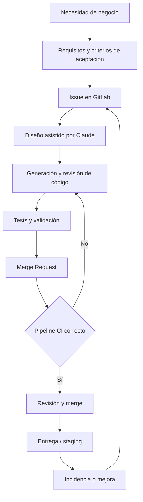

# Ciclo continuo de ALM generativo y CI/CD

Este diagrama presenta el flujo iterativo de desarrollo del coworking, desde la necesidad del negocio hasta el mantenimiento y la siguiente mejora. **La línea «Pipeline CI correcto» representa la validación CI del código**; no debe confundirse con el segundo recorrido del taller, donde GitLab ejecuta automáticamente los metaprompts de todas las fases ALM.

**Cómo leer los dos bucles:**

- Si falla CI, se vuelve a revisar código y pruebas; después se propone una nueva versión mediante Merge Request.
- Una vez entregado el software, una incidencia o mejora crea una nueva issue; antes de implementarla, hay que revisar si cambia los requisitos y el diseño. En el taller, la evolución CAM-01 añade la duración máxima de cuatro horas.
- En la modalidad guiada de L03–L09, el alumno dirige estas acciones con Claude. En la modalidad automática L10, GitLab orquesta la generación de los artefactos mediante los metaprompts, pero la revisión de negocio y el merge siguen siendo humanos.

El esquema es conceptual: no implica que los jobs de CI generen por sí mismos nuevas especificaciones, ni que una merge request se apruebe automáticamente.
